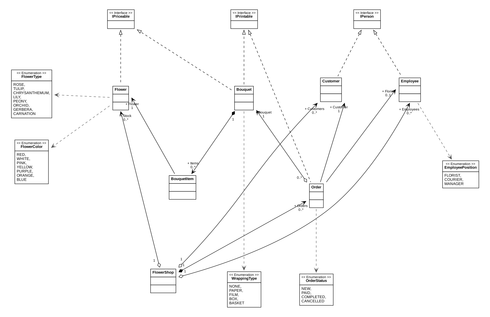
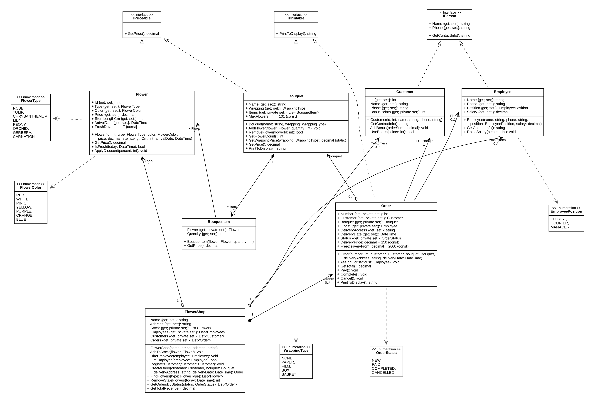

# OOP_Project_FlowerShop — Квітковий магазин

Проєкт (частина А) з дисципліни «Об’єктно-орієнтоване програмування».
Тема: **відношення між класами — асоціація, агрегація, композиція, реалізація**.

Виконала: Велигодська А.С., група 621п, ХАІ, 2026.

## Предметна область

Квітковий магазин приймає на склад квіти, складає з них букети і продає їх клієнтам з доставкою.
Магазин має склад квітів, працівників (флористи, кур’єри, менеджер), зареєстрованих клієнтів і замовлення.
Клієнт обирає букет, магазин створює замовлення, призначає флориста, клієнт оплачує замовлення
і отримує бонусні бали; після складання букета замовлення виконується, або його можна скасувати.

## Структура рішення

| Проєкт | Вміст |
|---|---|
| `OOP_Project_FlowerShop` | консольний застосунок .NET 10: класи, інтерфейси і переліки предметної області, кожен в окремому файлі *.cs |
| `OOP_Project_FlowerShop.Tests` | проєкт модульних тестів MSTest: 5 тест-класів, 62 тест-методи, 79 тестових випадків |

- **Класи:** `FlowerShop`, `Flower`, `Bouquet`, `BouquetItem`, `Order`, `Customer`, `Employee`
- **Інтерфейси:** `IPerson`, `IPriceable`, `IPrintable`
- **Переліки:** `FlowerType`, `FlowerColor`, `WrappingType`, `OrderStatus`, `EmployeePosition`

## Відношення між класами

| Класи | Відношення |
|---|---|
| `FlowerShop` → `Order` | композиція: замовлення створює тільки магазин (метод `CreateOrder`) |
| `Bouquet` → `BouquetItem` | композиція: позиції створює сам букет (метод `AddFlower`) |
| `FlowerShop` → `Flower`, `Employee`, `Customer` | агрегація: у магазин передаються готові об’єкти |
| `Order` → `Bouquet` | агрегація: готовий букет передається в конструктор `Order` |
| `Order` → `Customer`, `Employee` (Florist); `BouquetItem` → `Flower` | асоціація |
| `Customer`, `Employee` → `IPerson`; `Flower`, `Bouquet` → `IPriceable`; `Bouquet`, `Order` → `IPrintable` | реалізація |

## Діаграма класів

Етап 1 — виявлення класів і зв’язків між ними:



Етап 2 — детальне проєктування класів:



## Каркас проєкту і unit-тести (TDD)

Згідно із завданням конструктори і методи класів не реалізовано: замість коду вони містять заглушку

```csharp
throw new NotImplementedException();
```

Unit-тести вже написано повністю: вони описують, як мають працювати методи.
Зараз **усі 79 тестів мають статус failed** — це очікуваний результат за принципом TDD.
Методи буде реалізовано в частині Б проєкту.

| Тест-клас | Тест-методів | Тестових випадків |
|---|---|---|
| `FlowerTests` | 7 | 15 |
| `BouquetTests` | 15 | 20 |
| `PersonTests` | 9 | 13 |
| `OrderTests` | 13 | 13 |
| `FlowerShopTests` | 18 | 18 |
| **Разом** | **62** | **79** |

## Запуск

Visual Studio 2026: відкрити `OOP_Project_FlowerShop.slnx`, **Тест → Виконати всі тести**.
